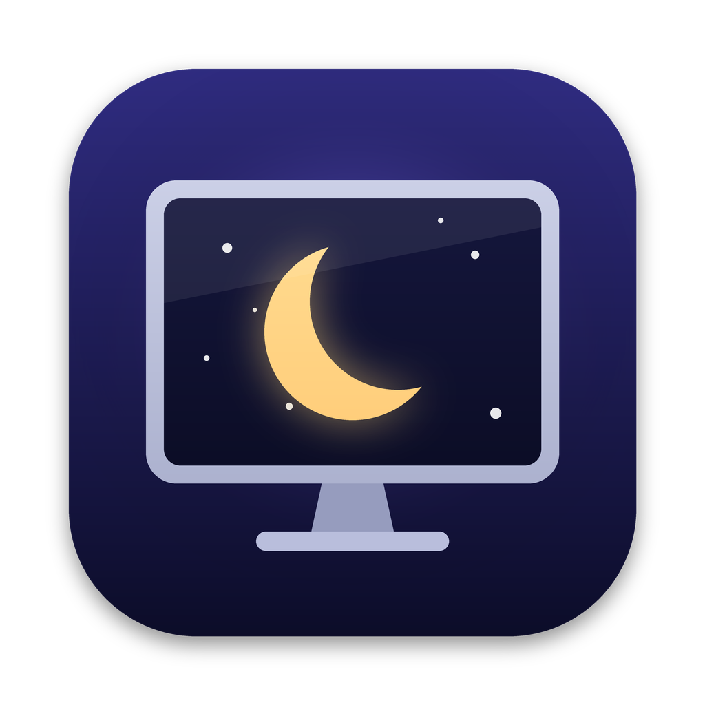

<p align="center">
  
</p>

<h1 align="center">GoDark</h1>

<p align="center">
  Turn individual Mac displays on and off, like blanking your MacBook's built-in screen while you work on an external monitor.
</p>

---

## Features

- **Per-display on/off switches** for the built-in display and every connected external monitor.
- **Really off, not just dimmed.** A disabled display is removed from the desktop, so windows, the Dock and the menu bar move to your other screens.
- **Built-in display safety net.** If the built-in display is off when your last external monitor is unplugged, GoDark turns it back on so you're never left without a screen.
- **Nothing is permanent.** Changes last only for the current session, so logging out or restarting turns every display back on. Quitting GoDark also turns the built-in display back on.
- **Remembers display names**, even while a display is off and macOS no longer reports it.

## Requirements

- macOS 26.6 or later
- Xcode 26 or later (to build)

## How to use it

1. Launch GoDark.
2. Turn off the switch next to a display to disable it, and turn it on to bring the display back.
3. You can close the window and GoDark keeps running so the safety net stays active. Click its Dock icon to open the window again.

GoDark won't let you turn off your last active display.

## Build from source

```sh
git clone https://github.com/dnafication/GoDark.git
cd GoDark
open GoDark.xcodeproj
```

Then press **⌘R** in Xcode, or build from the command line:

```sh
xcodebuild -project GoDark.xcodeproj -scheme GoDark build
```

Signing uses the team set in the project, so choose your own under **Signing & Capabilities**. See the [developer guide](docs/DEVELOPMENT.md) for building, running and relaunching from the terminal.

## Contributing

Contributions are welcome. Please read [CONTRIBUTING.md](CONTRIBUTING.md) first, especially the notes on the built-in display safety net. Report security problems as described in [SECURITY.md](SECURITY.md).

## Licence

GoDark is released under the [MIT licence](LICENSE).

## Install on other Macs

See [Distributing GoDark](#distributing-godark) below for creating a `.app` or `.dmg`.

## How it works

macOS doesn't offer a public API for turning a display off, so GoDark uses two private CoreGraphics functions:

| Function | Purpose |
| --- | --- |
| `CGSConfigureDisplayEnabled` | Enables or disables a display |
| `CGSGetDisplayList` | Lists every display, including disabled ones |

To WindowServer, disabling a display looks the same as unplugging it. Because GoDark uses private API, **it can't be distributed on the Mac App Store**, and a future macOS update could break it.

## Troubleshooting

**My built-in screen stayed off.** Log out or restart, and every display comes back on. You can also quit GoDark, which turns the built-in display back on.

**Logs.** To see what GoDark did, run:

```sh
/usr/bin/log show --last 10m --info --predicate 'subsystem == "com.dnafication.GoDark"'
```

## App icon

The icon is generated by [`scripts/make_icon.py`](scripts/make_icon.py), which needs [Pillow](https://pypi.org/project/pillow/):

```sh
pip3 install pillow
python3 scripts/make_icon.py
```

The script writes every required size into `GoDark/Assets.xcassets/AppIcon.appiconset` and a preview to `docs/icon.png`.

## Distributing GoDark

### Option 1: Export a signed `.app` from Xcode (recommended)

1. In Xcode choose **Product ▸ Archive**.
2. When the Organizer window opens, select the archive and click **Distribute App**.
3. Pick one of these methods:
   - **Direct Distribution.** Xcode signs the app with your *Developer ID* certificate and sends it to Apple to be notarized. The result opens on any Mac without warnings. This needs a paid Apple Developer Program membership.
   - **Custom ▸ Copy App.** Exports the app signed with your development certificate. That's fine for your own Macs, but other Macs show a Gatekeeper warning the first time (see [First launch on another Mac](#first-launch-on-another-mac)).
4. Choose a folder, and Xcode exports `GoDark.app` there.

### Option 2: Build a `.app` from the command line

```sh
xcodebuild -project GoDark.xcodeproj -scheme GoDark -configuration Release \
  -derivedDataPath build clean build
```

The app is written to `build/Build/Products/Release/GoDark.app`.

### Create a `.dmg` installer

With `GoDark.app` in hand, create a disk image with a shortcut to `/Applications` so people can drag to install:

```sh
mkdir -p dmg
cp -R path/to/GoDark.app dmg/
ln -s /Applications dmg/Applications

hdiutil create -volname "GoDark" -srcfolder dmg -ov -format UDZO GoDark.dmg
rm -rf dmg
```

For a nicer-looking DMG (background image, icon positions), use the free [`create-dmg`](https://github.com/create-dmg/create-dmg) tool:

```sh
brew install create-dmg
create-dmg --volname "GoDark" --window-size 540 360 --icon-size 128 \
  --icon "GoDark.app" 140 170 --app-drop-link 400 170 \
  GoDark.dmg path/to/GoDark.app
```

### Notarize the DMG (Developer ID only)

If you exported with Direct Distribution, the app inside is already notarized. To also notarize the DMG itself:

```sh
# One-time setup: save your credentials in the keychain
xcrun notarytool store-credentials GoDark --apple-id you@example.com \
  --team-id <TEAM_ID> --password <app-specific-password>

codesign --sign "Developer ID Application" --timestamp GoDark.dmg
xcrun notarytool submit GoDark.dmg --keychain-profile GoDark --wait
xcrun stapler staple GoDark.dmg
```

### First launch on another Mac

If the app isn't notarized, macOS blocks it the first time you open it. To allow it:

1. Open GoDark once, then dismiss the warning.
2. Open **System Settings ▸ Privacy & Security**, scroll down and click **Open Anyway** next to the GoDark message.

Or remove the quarantine flag from Terminal:

```sh
xattr -dr com.apple.quarantine /Applications/GoDark.app
```
